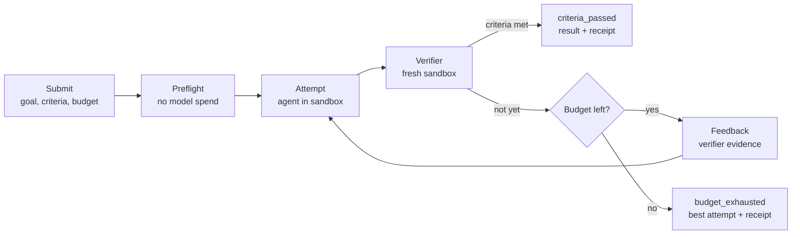

# Proofwork

**Agents that prove their work.**

> **Status: design stage.** There's no code yet. This README describes what's being built and how each claim will be tested. Measured results will replace the plans below as each piece lands. The full design (architecture, data model, failure modes, security model) is in [docs/design.md](docs/design.md).

Proofwork is a platform for running AI agents against outcomes that can be checked. You say what "done" means and the most you're willing to spend. Proofwork runs agents in isolated sandboxes, checks each result with an independent verifier in a fresh sandbox, and keeps iterating until the stated criteria pass or the budget runs out. Every run is durable, streamable and itemised to the cent.

## The problem

Agent systems tend to fail in the same few ways:

- **False success.** The agent says "done", but the tests still fail, or it made them pass by editing the tests.
- **Overspend.** Retries and parallel attempts spend more than anyone agreed to, because budgets are checked after the money is gone.
- **Fragile long runs.** A restart or a dropped connection loses work, or repeats half-finished side effects on retry.
- **Opaque failures.** Nobody can say which step went wrong, or what it cost, without running it again.

## The idea: make the outcome the unit of work

You submit a goal, success criteria and a budget:

```json
{
  "goal": "Make the failing date parsing test pass without editing tests",
  "workspace": { "type": "git", "url": "https://github.com/you/demo-date-lib" },
  "setup": "npm ci",
  "criteria": [{ "type": "command", "run": "npm test" }],
  "editable_paths": ["src/**"],
  "budget": { "usd": "1.00" }
}
```

Proofwork handles everything about *how*. Every outcome ends in one of four statuses, with the best attempt, an itemised receipt and a full trace:

| Status | Meaning |
|---|---|
| `criteria_passed` | Every stated criterion, visible and holdout, passed on a clean copy of the workspace. The receipt lists each check that ran. The name is deliberate: a verifier can only prove the criteria it was given, not the goal itself. |
| `budget_exhausted` | Money, tokens, time or the attempt limit ran out. Returns the best partial attempt and how close it got. |
| `failed` | Stopped for another reason: the criteria were unusable before any spend (they already passed, or were flaky), the agent got stuck, the model refused, or the environment kept failing. |
| `cancelled` | Stopped by the developer. |



## Claims, and how each one gets tested

| Claim | How it's tested |
|---|---|
| **Verifier soundness.** `criteria_passed` means the stated criteria passed on a clean copy of the workspace with only the attempt's diff applied. | Tamper injection: attempts that edit protected tests, test configs, mocks or dependencies; that write outside the editable paths; that smuggle changes through symlinks or ignore rules; or that leave state behind in their own sandbox. Target: none accepted. The design doc says exactly where tampering (soundness) ends and gaming the criteria in editable code (adequacy) begins. |
| **Criteria adequacy.** How often the criteria pass when the goal wasn't really met. | Developers can mark criteria as holdouts: the agent never sees them, but the verifier runs them. In evals, the false-pass rate is measured against hidden tests, including deliberately underspecified tasks where the visible tests can pass while the goal isn't met (for example, a date parser that ignores time zones). Measured and published, not promised as zero. |
| **Ledger invariant.** The budget ledger never starts a model call whose maximum cost could cross the limit, including with parallel attempts and crashes. | Property tests over thousands of random interleavings of reserve, settle, crash, cancel and timeout. This proves the ledger's arithmetic. |
| **Reservation adequacy.** Each call's actual cost stays within what was reserved for it. | Checked on every real call against the usage the API reports. This is measured, not proved, because it depends on token counts and billing outside Proofwork's control. Any breach is published. |
| **Durable runs.** Crashes and disconnects never lose or duplicate events. | Chaos suite: kill worker processes, the server and sandboxes mid-step, drop client streams, expire leases early. |

The two budget claims together keep model spend under the limit: the first is proved, the second is measured. The budget caps model spend. Sandbox time is metered and shown on the receipt, but not capped in v1.

## How the core works

- **Budget engine.**
  - Before each model call, Proofwork counts the input tokens with Claude's token-counting endpoint. It adds a safety margin, because the endpoint documents its count as an estimate.
  - It then reserves the most the call could cost, at the right rate card. That includes higher long-prompt pricing and the cache lifetime in use.
  - After the call it settles to the actual cost.
  - A crash, a cancellation or a timeout settles at the full reservation, so failures can only make Proofwork under-spend.
  - Retries happen in the harness, never silently inside the SDK, so each one is reserved as a new call.
  - Each attempt has its own cap.
  - Money is stored as BigInt integers in units finer than a micro-dollar, and always rounded up.
- **Two kinds of deduplication.** The event log deduplicates by step. The budget ledger deduplicates by billable call, so a retried step is charged as the new call it is.
- **Verifier.**
  - Proofwork's runner produces the attempt's diff, not the agent.
  - The verifier applies the diff to a fresh sandbox built from a squashed snapshot of the workspace, so there's no git history to dig answers out of.
  - It rejects changes to protected paths (tests, test configs, mocks, dependencies) or outside the optional editable paths, then runs the visible criteria.
  - If those pass, holdout criteria run in a second fresh sandbox. Nothing from that sandbox ever reaches the agent.
  - Verdicts are `pass`, `fail` or `error`, so a broken environment is never reported as a failed fix.
  - Before any spend, a preflight checks that the criteria fail on the base commit and aren't flaky.
  - LLM rubric grading is the weakest kind of check. The grader sees the goal, the rubric and the diff, and a rubric can't be the only criterion unless the developer opts in.
- **Durable runs.**
  - A single writer per outcome owns an append-only event log. A rebuild test checks that replaying the log reproduces the state.
  - Workers run as separate processes and hold per-attempt leases with fencing tokens. Tokens are checked on every budget reservation, every tool call and every commit. So a worker that freezes and comes back can't spend, touch the sandbox or overwrite newer work.
  - Each committed step checkpoints the workspace, so a retried step starts exactly where the log says it should.
  - Irreversible actions record an intent first and are never retried automatically.
- **Streaming.** Server-sent events with `Last-Event-ID`. A reconnecting client gets a replay from the log, then the live tail, with no gaps or duplicates.
- **Strategies.**
  - `iterate` continues the attempt with the verifier's evidence added.
  - `fanout` runs fresh attempts in parallel and cancels the rest as soon as one is verified.
  - `auto` starts with one attempt and fans out when the same failure repeats, before stuck detection can stop the run.
  - Per-test results from JUnit reports rank attempts and spot repeated failures.
  - Fan-out pre-warms the shared prompt cache with a separate call before launching, because parallel requests can't read a cache entry that's still being written.

## Scope

The core gets finished properly before anything else starts.

| Core (built first) | Stretch (after the core ships) |
|---|---|
| Outcome API, SSE streaming with `Last-Event-ID` resume | Hosted deployment (Cloudflare, Neon, R2) |
| Agent harness with prompt caching and output truncation | Self-hosted runners |
| Verifier in fresh sandboxes, protected and editable paths, holdout criteria, preflight | Approvals by email |
| Reserve-and-settle budget ledger with property tests | Credential vault, egress proxy, network allowlists |
| Event log, leases and fencing tokens, workspace checkpoints, chaos suite | Python SDK, dated API versions, webhooks |
| `iterate`, `fanout` and `auto` strategies | Memory across outcomes |
| Evals E1 and E2, starting with pilots | Load testing and a game day |
| TypeScript SDK, CLI, trace viewer, demo video | Multi-tenant row-level security, OpenTelemetry export |

The core is built local-first: TypeScript on Node, SQLite, and Docker with gVisor, calling the Claude API. A server process runs the coordinator, and workers run as child processes. Agents run offline after a setup step. Evals always run against the local stack.

## Evaluation plan

Tasks are written for this project. The first set is about 12, three of them deliberately underspecified, and the suite grows toward 40 if the first results justify it. The categories:
- Bug fixes with hidden tests.
- Small features.
- Data transformations.
- Tasks with awkward setup.
- Long tasks that overflow the context window.
- Underspecified goals, where the visible tests can pass while the goal isn't really met.

Each task is validated before use: the base fails, the reference solution passes everything, and the hidden tests catch a known-bad fix. Hidden tests and reference solutions are kept out of this public repo, and agents run with no network access.

| ID | Question |
|---|---|
| **E1** | Does iterating with a verifier beat a single attempt per dollar? Does fanning out beat iterating? |
| **E2** | Which harness features (compaction, a planning scaffold, a self-check step) stop helping as models get stronger? Tested one factor at a time on Haiku, then on a Sonnet subset and a few Opus runs. Caching isn't a factor here: it changes cost, not outputs, so its savings are computed from usage data. |
| E3 | How often does the rubric grader pass work that a human would fail? |
| E4 | Does memory help on repeated work? |
| E5 | How well do runs recover from injected tool errors, API errors and crashes? |

E1 and E2 are part of the core. E3 to E5 follow.

**Method.**
- Every configuration runs at least three times per task, with paired comparisons and bootstrap confidence intervals.
- Each result records the model, a hash of the harness configuration, and the task version.
- Metrics are success rate, pass^k (succeeds on all k runs), cost per success, attempts per success and false-pass rate.
- With 12 tasks, only large differences (around 20 points) are detectable, and with 40, around 12. Results are reported with that in mind.
- Evals are paid out of pocket, so they run in tiers: Haiku pilots first, Sonnet on a subset, very little Opus.
- CI never calls the real API. It replays recorded responses.

## Prior art

- **Durable execution:** Temporal, Restate.
- **Sandboxes:** E2B, Modal, Daytona.
- **Hosted agent platforms,** including Anthropic's Managed Agents, which already offers rubric-graded outcomes and per-session budgets.

Proofwork isn't trying to replace these. It's an end-to-end build of the hard parts, done in the open so that specific guarantees can be tested and measured. Two design choices set it apart. The verifier prefers executable criteria run in fresh sandboxes over model grading. And the budget reserves each call's maximum cost before making it, so a call that could cross the limit is never started, then checks every call's actual cost against that reservation. The price is that the last call may be shrunk or refused.

## Roadmap

| Phase | Scope | Exit criteria |
|---|---|---|
| **v0: Walking skeleton** | Budget ledger with property tests (first, because it guards real money), runner with setup and offline sandboxes, verifier in a fresh container with `command` criteria, harness built against a stub model server, `git` and `snapshot` workspaces, CLI. Eval task writing starts here. | Ledger property tests pass. The CLI fixes a toy repo end to end with a real Haiku run and prints a receipt. |
| **v1: Outcome loop** | Preflight, protected and editable paths, tamper suite, holdouts in their own sandbox, `check` criteria, per-test results and stuck detection, `iterate` / `fanout` / `auto`, recorded responses for replay, E1 pilot. | Zero tampering accepted. Ledger property tests pass under a fan-out simulation, and every real call is checked against its reservation. First E1 results published. |
| **v2: Durability** | Event log with a rebuild test, worker processes, leases with fencing tokens, workspace checkpoints, SSE resume, chaos suite, E2 pilot. | The chaos suite passes with zero lost or duplicated events. E2 results published. |
| **v3: Ship the core** | `rubric` criteria, TypeScript SDK, trace viewer, quickstart, demo video. | A developer who has Docker, Node and a Claude API key gets a first verified outcome in under five minutes from the quickstart. |

Stretch items, including hosted deployment, start only after v3.
