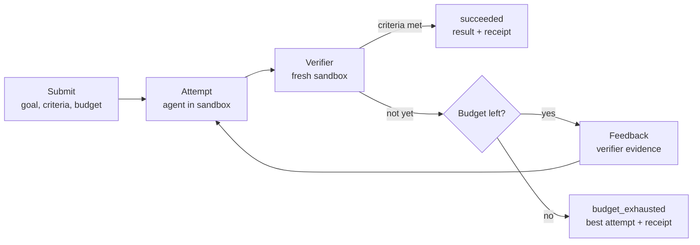

# Proofwork

**Agents that prove their work.**

> **Status: design stage.** There's no code yet. This README describes what's being built and how each claim will be tested. Measured results will replace the plans below as each piece lands. The full design doc (architecture, data model, failure modes, security model) is being revised and will be added under `docs/`.

Proofwork is a platform for running AI agents against outcomes that can be checked. You say what "done" means and the most you're willing to spend. Proofwork runs agents in isolated sandboxes, checks each result with an independent verifier in a fresh sandbox, and keeps iterating until the outcome is verified or the budget runs out. Every run is durable, streamable and itemised to the cent.

## The problem

Agent systems tend to fail in the same few ways:

- **False success.** The agent says "done", but the tests still fail, or it made them pass by editing the tests.
- **Overspend.** Retries and parallel attempts spend more than anyone agreed to, because budgets are checked after the money is gone.
- **Fragile long runs.** A restart or a dropped connection loses work, or repeats half-finished side effects on retry.
- **Opaque failures.** Nobody can say which step went wrong, or what it cost, without running it again.

## The idea: make the outcome the unit of work

You submit a goal, success criteria and a budget:

```json
{
  "goal": "Make the failing date parsing test pass without editing tests",
  "workspace": { "type": "git", "url": "https://github.com/you/demo-date-lib" },
  "criteria": [{ "type": "command", "run": "npm test" }],
  "protected_paths": ["tests/**"],
  "budget": { "usd": "1.00" }
}
```

Proofwork handles everything about *how*. Every outcome ends in one of four statuses, with the best attempt, an itemised receipt and a full trace:

| Status | Meaning |
|---|---|
| `succeeded` | The verifier passed every criterion on a clean copy of the workspace. |
| `budget_exhausted` | Money, tokens or time ran out. Returns the best partial attempt and how close it got. |
| `failed` | Stopped for another reason: the agent got stuck, or the environment broke. |
| `cancelled` | Stopped by the developer. |



## Claims, and how each one gets tested

| Claim | How it's tested |
|---|---|
| **Verifier soundness.** `succeeded` means the stated criteria passed on a clean copy of the workspace with only the attempt's diff applied. | Tamper injection: attempts that edit protected tests, test configs or test scripts, or leave state behind in their own sandbox. Target: none accepted. |
| **Criteria adequacy.** How often the criteria pass when the goal wasn't really met. | False-pass rate against hidden tests the agent never sees. Measured and published, not promised as zero. |
| **No budget overshoot.** Model spend never exceeds the limit, including with parallel attempts and crashes. | Property tests over random interleavings of reserve, settle and crash, plus a check on every call that the actual cost stayed within the reservation. |
| **Durable runs.** Crashes and disconnects never lose or duplicate events. | Chaos suite: kill workers and runners mid-step, drop client streams, expire leases early. |

The budget caps model spend. Sandbox time is metered and shown on the receipt, but not capped in v1.

## How the core works

- **Budget engine.** Before each model call, Proofwork counts the input tokens with Claude's token-counting endpoint, adds a safety margin (the endpoint documents its count as an estimate), and reserves the most the call could cost. After the call it settles to the actual cost. A crash or a cancellation settles at the full reservation, so failures can only make Proofwork under-spend. Money is stored as integers in units finer than a micro-dollar and always rounded up.
- **Two kinds of deduplication.** The event log deduplicates by step. The budget ledger deduplicates by billable call, so a retried step is charged as the new call it is.
- **Verifier.** Applies the attempt's diff to a fresh sandbox built from a squashed snapshot of the workspace, so there's no git history to dig answers out of. It restores protected files (tests, test configs and test scripts) from the base commit, then runs the criteria. Executable criteria come first. LLM rubric grading is the weakest kind of check: the grader sees only the diff and the rubric, and a rubric can't be the only criterion unless the developer opts in.
- **Durable runs.** A single writer per outcome owns an append-only event log. Workers hold leases with fencing tokens, so a worker that freezes and comes back can't overwrite newer work. Irreversible actions record an intent first and are never retried automatically.
- **Streaming.** Server-sent events with `Last-Event-ID`. A reconnecting client gets a replay from the log, then the live tail, with no gaps or duplicates.
- **Strategies.** `iterate` feeds the verifier's evidence into the next attempt. `fanout` runs attempts in parallel and cancels the rest as soon as one is verified. `auto` starts with one attempt and fans out when the same failure repeats. Fan-out pre-warms the shared prompt cache before launching, because parallel requests can't read a cache entry that's still being written.

## Scope

The core gets finished properly before anything else starts.

| Core (built first) | Stretch (after the core ships) |
|---|---|
| Outcome API, SSE streaming with `Last-Event-ID` resume | Self-hosted runners |
| Agent harness with prompt caching and output truncation | Approvals by email |
| Verifier in a fresh sandbox, protected paths, hidden tests | Credential vault and egress proxy |
| Reserve-and-settle budget ledger with property tests | Python SDK, dated API versions, webhooks |
| Event log, leases and fencing tokens, chaos suite | Memory across outcomes |
| `iterate`, `fanout` and `auto` strategies | Load testing and a game day |
| Evals E1 and E2 | Multi-tenant row-level security, OpenTelemetry export |
| TypeScript SDK, CLI, trace viewer, demo video | |

The core is built local-first: TypeScript on Node, SQLite, and Docker with gVisor, calling the Claude API. Moving coordination to Cloudflare Durable Objects and compute to a hosted VM comes once the core works. Evals always run against the local stack.

## Evaluation plan

About 40 tasks written for this project: bug fixes with hidden tests, small features, data transformations, tasks with awkward setup, and long tasks that overflow the context window. Hidden tests and reference solutions are kept out of this public repo, and agents get no network access to code hosts during eval runs.

| ID | Question |
|---|---|
| **E1** | Does iterating with a verifier beat a single attempt per dollar? Does fanning out beat iterating? |
| **E2** | Which harness features (prompt caching, compaction, a planning scaffold, a self-check step) stop helping as models get stronger? Tested one factor at a time across the Haiku, Sonnet and Opus tiers. |
| E3 | How often does the rubric grader pass work that a human would fail? |
| E4 | Does memory help on repeated work? |
| E5 | How well do runs recover from injected tool errors, API errors and crashes? |

E1 and E2 are part of the core. E3 to E5 follow.

Every configuration runs at least three times per task, with paired comparisons and bootstrap confidence intervals. Each result records the model, a hash of the harness configuration, and the task version. Metrics are success rate, pass^k (succeeds on all k runs), cost per success, attempts per success and false-pass rate.

## Prior art

- **Durable execution:** Temporal, Restate.
- **Sandboxes:** E2B, Modal, Daytona.
- **Hosted agent platforms,** including Anthropic's Managed Agents, which already offers rubric-graded outcomes and per-session budgets.

Proofwork isn't trying to replace these. It's an end-to-end build of the hard parts, done in the open so that specific guarantees can be tested and measured. Two design choices set it apart. The verifier prefers executable criteria run in a fresh sandbox over model grading. And the budget reserves each call's maximum cost before making it, so a call that could cross the limit is never started. The price is that the last call may be shrunk or refused.

## Roadmap

| Phase | Scope | Exit criteria |
|---|---|---|
| **v0: Walking skeleton** | One attempt, `command` criteria, verifier in a fresh container, simple ledger, harness with core tools, CLI. Eval task writing starts here. | The CLI fixes a toy repo end to end and prints a receipt. |
| **v1: Outcome loop** | Reserve-and-settle ledger, protected paths and tamper tests, `iterate` / `fanout` / `auto`, E1. | Property tests show zero overshoot. First E1 results published. |
| **v2: Durability** | Event log, leases and fencing tokens, SSE resume, chaos suite, E2. | The chaos suite passes with zero lost or duplicated events. E2 results published. |
| **v3: Ship the core** | TypeScript SDK, trace viewer, hosted deployment, demo video. | A new developer gets a first verified outcome in under five minutes. |

Stretch items start only after v3.
