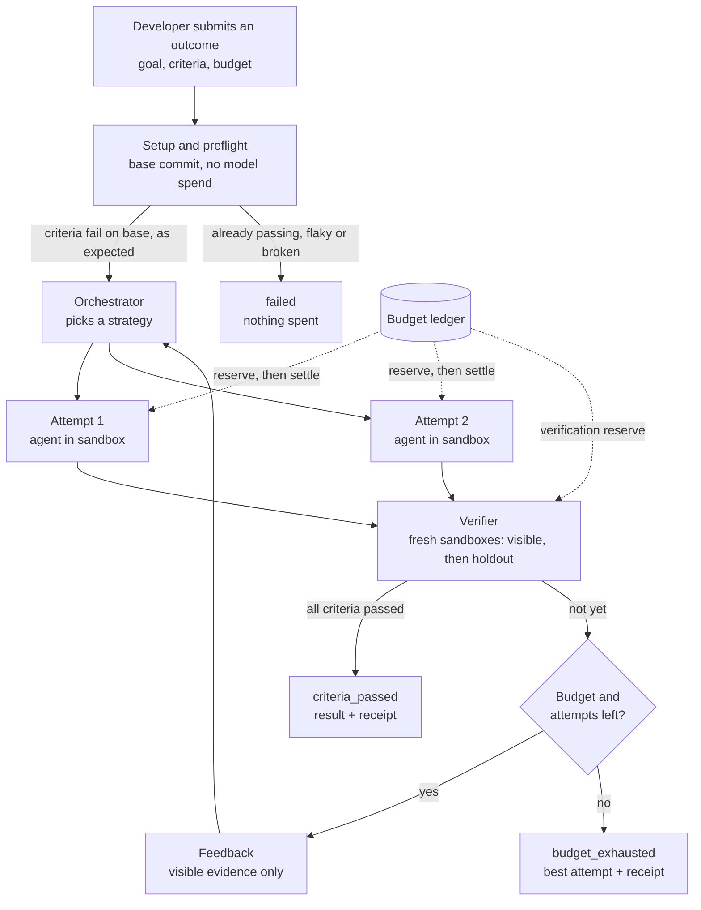
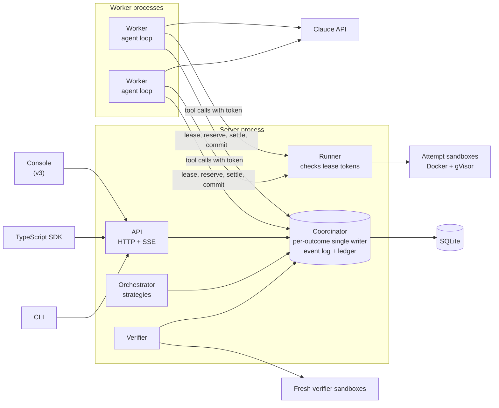
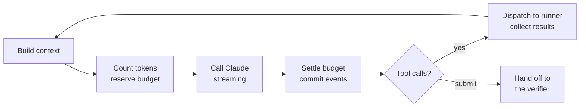
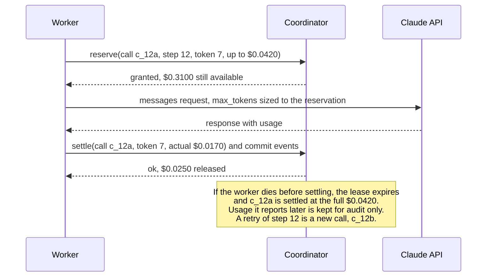
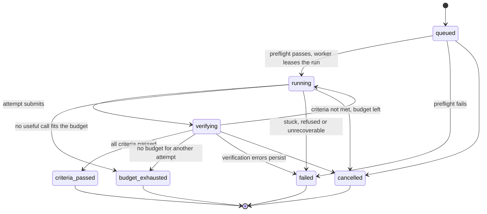
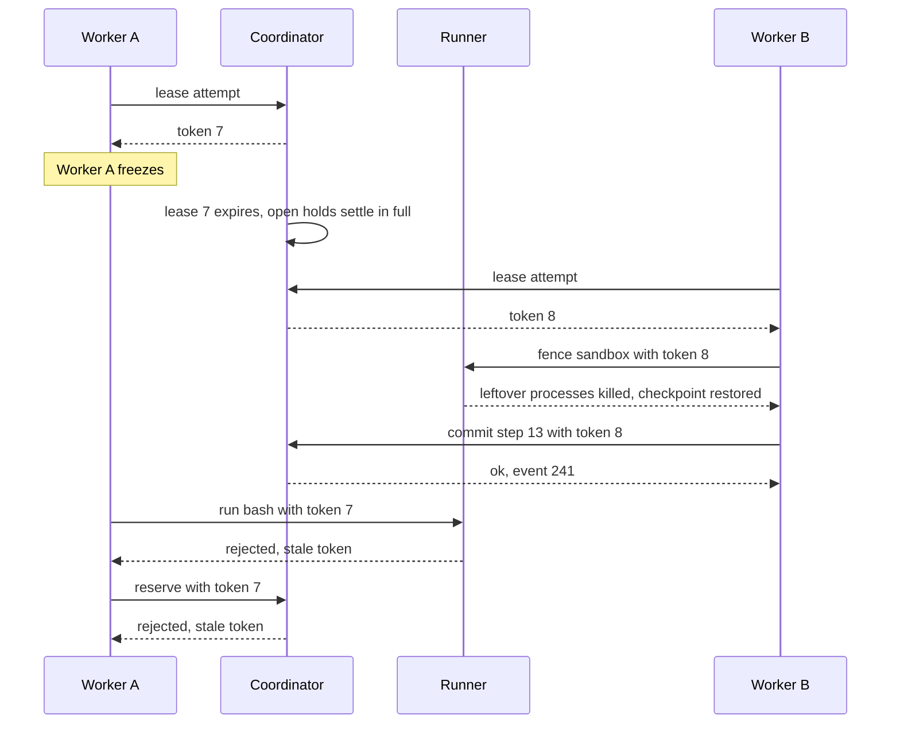
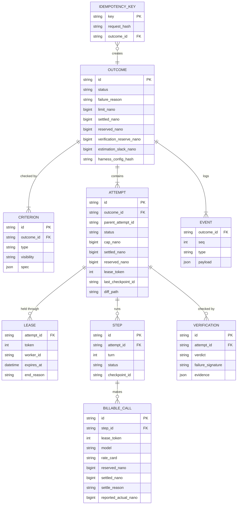

# Proofwork design

> **Agents that prove their work.**

| | |
|---|---|
| **Status** | Design. No code yet. |
| **Owner** | Deep Mehta |
| **Last updated** | 9 November 2026 (revised after a design review; see section 19) |
| **Core stack** | TypeScript on Node, SQLite, Docker with gVisor, Claude API |
| **Later, hosted** | Cloudflare Workers and Durable Objects, Neon Postgres, Cloudflare R2 |

This document describes what Proofwork is, how it works, and how each of its claims will be tested. The [README](../README.md) is the short version. Sections marked **stretch** describe work that starts only after the core ships.

## Contents

1. [Problem](#1-problem)
2. [Goals, non-goals and success metrics](#2-goals-non-goals-and-success-metrics)
3. [Core concepts](#3-core-concepts)
4. [How a run works](#4-how-a-run-works)
5. [Architecture](#5-architecture)
6. [Core components](#6-core-components)
7. [Stretch areas](#7-stretch-areas)
8. [API sketch](#8-api-sketch)
9. [Data model](#9-data-model)
10. [Failure modes](#10-failure-modes)
11. [Security model](#11-security-model)
12. [Evaluation plan](#12-evaluation-plan)
13. [Infrastructure and cost](#13-infrastructure-and-cost)
14. [Repository layout](#14-repository-layout)
15. [Roadmap](#15-roadmap)
16. [Demo and proof artifacts](#16-demo-and-proof-artifacts)
17. [Prior art](#17-prior-art)
18. [Risks and open questions](#18-risks-and-open-questions)
19. [Revision history](#19-revision-history)

---

## 1. Problem

### 1.1 The situation

Models are now good enough to fix bugs, build features and transform data with little supervision. The hard part has moved from the model to the system around it. Every team that ships an agent ends up hand-rolling the same pieces: an agent loop, a sandbox to run code in, somewhere to keep state, retry and recovery logic, and spend controls.

### 1.2 What goes wrong

Even with those pieces in place, agent systems fail in the same recurring ways.

| # | Problem | What it looks like |
|---|---|---|
| P1 | **False success** | The agent says "done" but the tests still fail, or it made them pass by editing the tests. |
| P2 | **Unbounded cost** | Retries and parallel attempts spend several times what anyone agreed to. Budgets are checked after the money is gone. |
| P3 | **Fragile long runs** | A restart or a dropped connection loses work, or repeats half-finished side effects on retry. |
| P4 | **Opaque failures** | Nobody can say which step went wrong, why, or what it cost, without running it again. |
| P5 | **Unsafe actions** | Agents hold raw credentials and can push code or send messages without anyone approving. (Addressed in stretch work, section 7.) |

### 1.3 Problem statement

> Developers who want an agent to achieve a concrete result have no simple, safe way to say *"achieve this, prove it, and don't spend more than this."* They build the loop, sandboxing, state, verification and cost control themselves, and the result still reports success it can't prove, overspends under concurrency, and loses work whenever something restarts.

### 1.4 The idea

**Make the outcome the unit of work.** A developer submits a goal, criteria that decide success, and a budget. Proofwork owns everything about *how*. It returns one of a small set of honest statuses, and the passing status is called `criteria_passed`, because an independent verifier can prove the stated criteria passed, not that the goal itself was achieved.

### 1.5 Who it is for

- Developers building coding agents, data-processing agents or internal automation who want verified results instead of best-effort ones.
- Teams that need hard spend limits per task, not just per month.
- Anyone who needs agents to run for a long time without losing work.

---

## 2. Goals, non-goals and success metrics

### 2.1 Goals

| ID | Goal | Addresses |
|---|---|---|
| G1 | **Sound verification.** `criteria_passed` means the verifier ran every visible and holdout criterion on a clean copy of the workspace with only the attempt's diff applied, and all of them passed. | P1 |
| G2 | **Honest about adequacy.** Measure and publish how often passing criteria still miss the goal. | P1 |
| G3 | **Hard budgets.** The ledger never starts a model call whose maximum cost could cross the limit, even with parallel attempts and crashes, and every call's actual cost is checked against what was reserved for it. | P2 |
| G4 | **Durable runs.** Crashes and disconnects never lose or duplicate work. | P3 |
| G5 | **Debuggable.** Every step is traceable with its cost, inputs and outcome. | P4 |
| G6 | **Stable contract.** The API and event schemas are written first, and internals can change behind them. | All |

### 2.2 Success metrics

| Metric | Target | How it's measured |
|---|---|---|
| Verifier soundness: tampering attempts accepted | 0 | Tamper suite: attempts that edit protected paths or files outside the editable paths, smuggle changes through the diff, or leave state behind in their own sandbox. Section 6.3 draws the line between soundness and adequacy. |
| Criteria adequacy: false-pass rate | Measured and published, with confidence intervals | Hidden tests on eval tasks, including deliberately underspecified tasks |
| Ledger invariant: reservations granted that could cross the limit | 0, proved | Property tests over random interleavings of reserve, settle, crash, cancel and timeout |
| Reservation adequacy: calls whose actual cost exceeded their reservation | Target 0, measured, every breach published | The per-call check against the usage the API reports |
| Events lost or duplicated under injected crashes | 0 | Chaos suite |
| Resume time after a worker crash (p95) | Measured and published | Chaos suite |
| Success per dollar: iterate and fan-out against a single attempt | Published, with confidence intervals | Eval E1 |
| Time to a first verified outcome for a new developer who already has Docker, Node and a Claude API key | Under 5 minutes from the quickstart | Timed quickstart with at least three people (v3) |

### 2.3 Non-goals

- Hosting or fine-tuning models. Proofwork calls the Claude API.
- Being a chat framework or a no-code agent builder.
- Payments or invoicing. Spend is tracked and enforced, not billed.
- Multi-region high availability.
- Supporting other model providers in v1. The model layer sits behind an interface so this can come later.
- Adding dependencies during a run. Attempts run offline and dependency files are protected (sections 6.1 and 6.8).
- Competing with hosted agent platforms. See section 17.

---

## 3. Core concepts

| Concept | Meaning |
|---|---|
| **Outcome** | One request to achieve a goal. Has criteria, a budget and a final status. |
| **Criterion** | One check that decides success: a command, a check script or a rubric. Each criterion is **visible** (the agent can see it) or a **holdout** (only the verifier sees it). |
| **Protected paths** | A denylist of files the agent must not change, such as tests, test configs and lockfiles. A diff that touches one is rejected. |
| **Editable paths** | An optional allowlist of files the agent may change, such as `src/**`. Stronger than a denylist. |
| **Budget** | A hard limit in USD on model spend, a cap per attempt, and optional token and wall-time limits. |
| **Preflight** | Checks run on the base commit before any model spend: the criteria must fail, the holdouts must run, and results must be stable. |
| **Attempt** | One agent working on the outcome in its own sandbox. An outcome has one or more. |
| **Step** | One turn of an attempt's agent loop. The event log deduplicates by step. |
| **Checkpoint** | A snapshot of an attempt's workspace taken after each committed step. A retried step starts from it. |
| **Billable call** | One request to the Claude API. The budget ledger deduplicates by call, so a retried step is charged as the new call it is. |
| **Verifier** | An independent checker that evaluates an attempt's diff in fresh sandboxes and returns `pass`, `fail` or `error`. |
| **Event** | An immutable, sequence-numbered record of something that happened. The event log is the source of truth, and a rebuild test checks it. |
| **Lease** | A short, renewable claim a worker holds on one attempt, with a fencing token that only increases. Every resource the worker touches checks the token. |
| **Receipt** | Itemised spend for an outcome, by attempt, role and call. |
| **Runner** | The component that executes tool calls inside sandboxes, takes checkpoints and produces diffs. |

---

## 4. How a run works



1. **Submit.** The developer sends a goal, criteria, protected and editable paths, and a budget. Proofwork returns an outcome ID and a stream URL immediately.
2. **Set up and preflight.** Proofwork squashes the workspace into a snapshot with no history and runs the setup command (such as `npm ci`) with network access. The result is cached by lockfile hash. Then, on the base commit and with no model spend, it checks that the visible criteria fail, that the holdouts run, and that the results are stable across repeated runs. If any check fails, the outcome ends before anything is spent.
3. **Plan.** The orchestrator runs one attempt and iterates, or fans out several attempts in parallel.
4. **Attempt.** Each attempt is an agent loop running Claude, with tools executing in the attempt's own sandbox, offline. Every model call reserves budget first.
5. **Submit for verification.** When an attempt believes it's done, it calls `submit`. The runner, not the agent, produces the diff against the base snapshot.
6. **Verify.** A fresh sandbox applies the diff, rejects changes to protected paths or outside the editable paths, and runs the visible criteria. If they all pass, a second fresh sandbox runs the holdouts. The attempt's own claims are ignored.
7. **Loop or finish.** On `fail`, evidence from the visible sandbox becomes feedback for the next attempt, as long as budget and attempt limits allow. A holdout failure is reported only as "a holdout check failed". On `error`, the verification is retried and never counted against the attempt.
8. **Return.** The outcome ends as `criteria_passed`, `budget_exhausted`, `failed` or `cancelled`, with the best attempt, an itemised receipt and a trace.

---

## 5. Architecture

### 5.1 Principles

1. **Single writer per outcome.** One coordinator owns each outcome's event log and budget ledger, so ordering and spend are strongly consistent without a lock service.
2. **Stateless workers, durable coordinator.** Workers hold no state that matters. They lease an attempt, do one step, commit it, and can die at any moment.
3. **The event log is the source of truth.** State tables are written in the same transaction as the events that change them, and a rebuild test checks that replaying the events reproduces the tables exactly. Traces, receipts and summaries are projections of the log.
4. **Fence everything.** A fencing token only protects the resources that check it. The coordinator checks it on every reservation and commit, and the runner checks it before every tool call.
5. **Contract first.** The API and event schemas are written before the code, and they're the only things clients depend on.
6. **Local-first.** The core runs on one machine. Moving to hosted infrastructure comes after the core works.
7. **Pull, not push.** Workers pull attempts with leases, so crash recovery is automatic.

### 5.2 Core architecture (local)

The core runs on one machine as two kinds of process:

- **The server:** one Node process holding the API, the coordinator, the orchestrator, the runner and the verifier.
- **Workers:** child processes that run the agent loop. They talk to the server over a small local RPC interface (lease, heartbeat, reserve, settle, dispatch a tool, commit). It's the same interface a hosted version would use.

Separate worker processes are what make lease takeover real. A worker can die on its own while the coordinator keeps running, and the chaos suite and the demo depend on that. In v0 and v1 a worker may run inside the server process behind the same interface. v2 moves workers into child processes.



| Component | Responsibility |
|---|---|
| **API** | Validates requests against the contract, enforces idempotency keys, serves SSE streams. |
| **Coordinator** | One logical actor per outcome. Owns the state machine, the append-only event log, the budget ledger, and leases with fencing tokens. Processes requests for an outcome one at a time. |
| **Orchestrator** | Deterministic strategy logic: when to start, fan out or stop attempts. It may make one model call to condense verifier evidence into feedback. |
| **Workers** | Child processes. Lease an attempt, run one agent step (build context, reserve, call Claude, settle, dispatch tools) and commit the result. |
| **Runner** | Executes tool calls inside an attempt's sandbox, rejects calls that carry an old lease token, takes workspace checkpoints and produces the attempt's diff. |
| **Verifier** | Runs preflight, builds fresh sandboxes per verification, and returns a verdict with evidence. |
| **SQLite** | Event log, ledger, outcomes, attempts, leases and verifications. |

**When something restarts.**

- **A worker dies.** Its lease expires, and its open reservations settle at their full hold. The next worker to lease the attempt fences the sandbox (section 6.6), restores the last committed checkpoint and carries on.
- **The server restarts.** Docker containers and worker processes can outlive it. Before accepting work, the server runs a reconcile pass:
  1. Treat every lease from before the restart as expired, and settle its open reservations at their full hold.
  2. Workers that lose their connection to the server exit. Any that come back carry stale tokens and are rejected everywhere.
  3. For each running attempt, rebuild the sandbox from the last committed checkpoint. Rebuilding kills any exec processes still running in the old container. Containers are labelled with their outcome and attempt IDs, so leftovers for finished attempts are found and removed.
  4. Discard in-progress verifications and run them again. They cost nothing unless they include rubric calls, which settle at their full hold like any other interrupted call.
  5. Queue running attempts for new leases. Clients reconnect with `Last-Event-ID`.

### 5.3 Later: hosted architecture (stretch)

The same interfaces map onto hosted infrastructure:

- **Coordinator:** one Cloudflare Durable Object per outcome.
- **Work queue:** a dispatcher Durable Object with per-tenant queues.
- **Compute:** workers and the runner on a VM.
- **Neon Postgres:** outcome summaries, projected from the event log with idempotent upserts keyed on `(outcome, seq)`.
- **R2:** artifacts, checkpoints and archived event logs.

Free-plan limits shape this design. At the time of writing, free-plan Durable Objects allow:
- 100,000 requests a day, counting HTTP requests, RPC sessions, WebSocket messages and alarms.
- 13,000 GB-s of active time a day.
- 100,000 SQL rows written a day.

Going over any one of these makes further operations of that type fail. So worker and runner connections would use hibernating WebSockets, SSE would be used only for clients, and evals would never run against the hosted stack. Check these limits before relying on them.

### 5.4 Key decisions

| Decision | Chosen | Alternatives | Why |
|---|---|---|---|
| Per-outcome coordination | Single-writer actor (in-process now, Durable Object later) | Postgres row locks | Strict ordering and an atomic ledger with no lock management; state and logic sit together; outcomes shard naturally |
| Process layout | A server process plus worker child processes | One process; a process per component | A worker has to be able to die on its own for lease takeover to be real, without running a distributed system locally |
| Build order | Local-first | Cloud-first | Free-tier request, active-time and row-write limits; the loop, verifier and ledger should be right before they're distributed |
| Sandbox isolation | Docker with gVisor | Plain Docker, Firecracker | A user-space kernel boundary without needing KVM |
| Sandbox network | Setup online, then the agent and verifier offline | A per-outcome domain allowlist | Docker has no built-in domain allowlist, and offline runs also block eval contamination |
| Work distribution | Pull with leases | Push | Crash recovery is automatic; works behind NAT |
| Client streaming | SSE with `Last-Event-ID` | WebSockets | One-way, passes through proxies, resume is built in |
| Money | Integer nano-dollars as BigInt internally, decimal strings in the API | Floats, micro-dollars, JavaScript numbers | Some per-token rates are below one micro-dollar; rounding direction matters; `tokens × price` can approach 2^53 |
| Input-token bound | Token-counting endpoint, plus a margin, plus ledger slack, plus a per-call check | Estimating | The counting endpoint is documented as an estimate that can differ slightly from billed usage |
| API retries | In the harness, with SDK retries off | The SDK's built-in retries | Every retry has to be a new billable call with its own reservation |
| `iterate` | Continue the previous attempt's workspace and conversation | Restart from the base commit | Builds on progress and keeps the prompt cache warm; restarting is a flag |
| Holdouts | Run in their own fresh sandbox, output never fed back | Mounted alongside the visible run | Test-runner globs and the attempt's own code can both leak them |
| Passing status name | `criteria_passed` | `succeeded` | The verifier proves the stated criteria, not the goal |

---

## 6. Core components

### 6.1 The outcome contract

**Workspace.** Two types:
- `git`: a public repository URL and ref. Proofwork clones it and squashes it to a snapshot.
- `snapshot`: an uploaded archive or, from the CLI, a local directory. Eval tasks use this type.

Either way, attempts and the verifier only ever see the squashed snapshot, so there's no git history to dig hidden tests or reference solutions out of.

**Setup.** An optional `setup` command, such as `npm ci`, runs once per snapshot with network access, before any agent starts. Its result is cached by a hash of the lockfile, so later outcomes with the same dependencies skip it. Attempts and the verifier then run offline (section 6.8).

**Criteria types**, from most to least trustworthy:

| Type | Example | Trust |
|---|---|---|
| `command` | Run `npm test`; pass if the exit code is 0 | Objective. Preferred. |
| `check` | A developer-supplied script that prints a JSON verdict with a reason | Objective if the script is sound |
| `rubric` | A model grades the diff against written criteria and returns a score | Weakest. Can't be the only criterion unless the developer opts in. |

**Per-test results.** A `command` criterion can declare a JUnit XML report, for example `"report": { "format": "junit", "path": "reports/junit.xml" }`. Vitest and pytest have a JUnit reporter built in; Jest needs the `jest-junit` reporter. The rules:
- The verifier deletes any existing report file before running the command.
- The exit code alone decides pass or fail. The report is only used to rank attempts and detect when they're stuck, so a forged report can't turn a fail into a pass.
- Without a report, a criterion counts as one test.

**Holdout criteria.** Any criterion can be marked `"visibility": "holdout"`. Holdouts work as follows:
- The agent never sees a holdout. It isn't in the prompt, the workspace or the visible verifier run.
- Holdout files are uploaded separately. They're mounted read-only at `/holdout`, outside the workspace, and only into the holdout sandbox (section 6.3). A holdout upload usually carries a small script that runs its tests against `/workspace`.
- Holdouts run only after every visible criterion has passed.
- If a holdout fails, the attempt fails. The agent's feedback says only that a holdout check failed: not which one, not what it tested, and none of its output.
- The developer gets full evidence in the receipt and trace.

Holdouts answer the adequacy problem in production, much as a test set does in machine learning. They catch an attempt that fits the visible checks but misses the goal.

**Protected paths** are a denylist. A diff that touches one is rejected, including a new file that matches a protected pattern. The defaults:
- Tests: `tests/**`, `test/**`, `**/__tests__/**`, `**/*.test.*`, `**/*.spec.*`.
- Mocks and fixtures: `**/__mocks__/**`, `**/fixtures/**`.
- Test and build configuration that changes what tests do:
  - `jest.config.*`, `vitest.config.*`, and `vite.config.*` (Vitest reads it).
  - `.mocharc.*` and `babel.config.*`.
  - `tsconfig*.json`, because path mappings can redirect imports.
  - `conftest.py` at any depth, `pytest.ini`, `tox.ini`, `setup.cfg`.
- In `package.json`, checked field by field:
  - `scripts`.
  - Test-runner keys such as `jest` and `mocha`.
  - The dependency fields.
- In `pyproject.toml`, the `[tool.pytest.ini_options]` table and the dependency tables.
- Lockfiles: `package-lock.json`, `pnpm-lock.yaml`, `yarn.lock`, `poetry.lock`, `uv.lock`.

**Editable paths** are an optional allowlist, such as `["src/**"]`. When it's set, a diff that touches any file outside it is rejected. A denylist will always miss something, so the allowlist is the stronger option, and every eval task sets one.

As a second line of defence, the verifier also restores protected paths from the base snapshot before running criteria. Section 6.3 defines which tricks count as soundness failures and which count as adequacy failures.

**Statuses.**

| Status | Meaning |
|---|---|
| `criteria_passed` | Every visible and holdout criterion passed on a clean copy of the workspace. The receipt lists each check. |
| `budget_exhausted` | Money, tokens, wall time or the attempt limit ran out. Returns the best attempt and how close it got. |
| `failed` | Stopped for another reason, given as `reason`: `preflight`, `stuck`, `environment` (verification errors that persisted) or `refusal`. |
| `cancelled` | Stopped by the developer. |
| `queued`, `running`, `verifying` | Non-terminal. |

**Best attempt.** When nothing passes, the best attempt is the one with the most visible tests passing. Per-test results are used where a report is declared, and whole criteria otherwise. Ties go to the smaller diff. The attempt's evidence is attached.

### 6.2 Orchestrator and strategies

| Strategy | How it works | When it wins |
|---|---|---|
| `iterate` | One attempt at a time. Each new attempt continues the previous attempt's workspace and conversation, with the verifier's feedback added as a new message. | Cheap, and the prompt cache stays warm. Good when failures are informative. |
| `fanout` | Several attempts in parallel, each starting from the base snapshot with a fresh conversation and told to try a different approach. | Faster, and escapes dead ends. Costs more. |
| `auto` | Starts like `iterate`. Fans out when the same failure repeats. Falls back to `iterate` when budget is low. | The default. |

**How `iterate` continues.**
- Each iteration is a new attempt for accounting, with its own ID, lease and per-attempt cap.
- It starts from the previous attempt's last committed checkpoint and keeps its conversation. The cached prefix carries over, and compaction handles growth.
- Each submitted diff is a candidate for best attempt.
- Restarting from the base snapshot with a fresh conversation is available as a flag (`iterate.restart: "fresh"`).

**Feedback.** The orchestrator may make one model call to condense verifier evidence into feedback for the next attempt. That call only ever sees evidence from the visible sandbox. From the holdout sandbox it gets a single fact: whether a holdout check failed.

**Fan-out rules.**
- Attempts are independent by default. Sharing evidence mid-flight is a flag, measured in E1.
- The moment one attempt passes verification, the others are cancelled. Their in-flight calls are settled at the full reservation, because their true cost is unknown.
- If several attempts pass in the same verification window, the smallest diff wins.

**Pre-warming the cache.** Parallel requests can't read a prompt-cache entry until the request that writes it starts streaming its response. So before fanning out, the orchestrator writes the shared prefix with one call that has `max_tokens: 0`. The rules for that call:
- It's a separate, non-streaming call, because `max_tokens: 0` is rejected with `stream: true` and inside batches.
- It uses the same model, system prompt, tools, and thinking and effort settings as the attempts. Otherwise it writes a cache entry they never read.
- Each attempt's distinct instructions go after the cache breakpoint.
- It reserves and settles like any other call, and is charged to the orchestrator role.

**Stopping rules.** A run stops on the first of these:
- An attempt passes verification.
- The budget, the wall-time limit or the attempt limit is reached.
- Stuck detection fires.
- Something can't be recovered: preflight fails, verification errors persist, or the model refuses on every attempt.

**Failure signatures and stuck detection.**
- A failure signature is the set of failing test IDs from the JUnit report, plus the first line of each error with numbers, paths and timestamps stripped. Without a report, it's the failing criterion IDs, their exit codes and the normalised last lines of output.
- `error` verdicts never produce a signature.
- Stuck detection fires when the same signature has been seen `stuck_after` times (default 3).
- **Ordering in `auto`:** the second occurrence of a signature triggers fan-out first, and the count restarts after fanning out. Fan-out always gets its chance before stuck detection can stop the run.

### 6.3 The verifier

**Verification**, step by step:

1. **Build the diff.** When an attempt submits, the runner produces its diff. The agent doesn't. The diff is computed against the runner's own copy of the base snapshot, never the sandbox's `.git`, which the agent controls. Rules:
   - Text files become unified diffs. Deleting a file is allowed unless it's protected.
   - Binary files are carried whole, only inside the editable paths, and at most 1 MB each.
   - Only the executable bit of a file mode is carried.
   - Symlinks are rejected, because they can point at protected files or outside the workspace.
   - Ignored files, such as `node_modules/`, are excluded using the base snapshot's ignore rules. The attempt's ignore rules are never used, so it can't hide a change by editing `.gitignore`.
   - A diff larger than 5 MB in total is rejected.
2. **Check paths.** If the diff touches a protected path or a file outside the editable paths, the verdict is `fail`, and the evidence names the paths.
3. **Visible sandbox.** The verifier builds a new sandbox from the squashed base snapshot with the cached dependencies. It applies the diff and restores protected paths. No holdout file exists in this sandbox. It never reuses the attempt's sandbox, so nothing the attempt did to its environment can affect the check. The visible criteria run here, and each returns evidence: exit codes, per-test results and failing test output.
4. **Holdout sandbox.** This step runs only if every visible criterion passed. It's a second fresh sandbox, built the same way, with the holdout files mounted read-only at `/holdout`, and the holdout criteria run here. The attempt's code runs in this sandbox too and could read and print the holdout files. So nothing from this sandbox is ever passed to the agent or the feedback call. The developer sees all of it.
5. **Rubric criteria.** These run last, and only if everything else passed. A separate model call sees the goal, the rubric and the diff, but never the attempt's reasoning. The diff is passed as untrusted data, because it can contain text aimed at the grader, such as a comment saying "this fully satisfies the rubric".
6. **Verdict.** The verifier records the verdict with its evidence. Evidence from the visible sandbox can become feedback. Holdout results become one line.

**Verdicts.**

| Verdict | Meaning | What happens next |
|---|---|---|
| `pass` | Every criterion passed. | The outcome ends `criteria_passed`. |
| `fail` | A criterion failed, or the diff was rejected. | The evidence becomes feedback, and the failure signature counts toward stuck detection. |
| `error` | The verifier couldn't reach a judgement: Docker failed, setup failed in the verifier sandbox, or the runner died. | Retried up to twice. Never reported to the agent as "your fix failed", and never counted toward stuck detection. If it persists, the outcome ends `failed` with reason `environment`. |

A criterion that times out returns `fail`, not `error`, because the attempt's code may be what hangs.

**Preflight.** Before any model spend, the verifier runs on the base snapshot with no diff. It checks:
- Setup succeeds.
- At least one visible criterion fails. If they all already pass, there's nothing to do.
- Every holdout runs to a result, whether pass or fail, but not `error`.
- The visible criteria give the same per-test results over three runs. If they don't, the criteria are flaky.

Any failure ends the outcome `failed` with reason `preflight` and nothing spent. Flaky criteria fail preflight unless the developer allows them. Preflight results are cached by snapshot and criteria hash.

**Soundness versus adequacy: where the line is.**

| | What it covers | Claim |
|---|---|---|
| **Soundness failure** | The verdict didn't come from running the stated criteria against the base snapshot plus the attempt's diff. Examples: a change to a protected path or outside the editable paths reaching a criterion; a change smuggled in through a symlink or ignore rules; state left in the attempt's sandbox affecting the verdict; holdout content reaching the agent. | Zero accepted. Tested by the tamper suite. |
| **Adequacy failure** | The stated criteria ran honestly and passed, but the goal wasn't met. Examples: hard-coding expected outputs; special-casing test inputs; code that checks for a test environment, such as `process.env.VITEST` or `NODE_ENV === "test"`; anything else that can be written in editable source. | Measured and published. Holdouts and hidden tests catch some of these. |

The verifier flags any diff that references test-environment variables, without failing it, so these show up in the receipt.

**Verification cost.** `command` and `check` criteria cost no model spend. Each `rubric` criterion costs one grader call. The verification reserve is computed from the criteria, not set as a percentage.

### 6.4 The harness



**Tools:** `bash`, `read_file`, `edit_file` (exact string replace), `search`, `git` (local only) and `submit` (the agent's claim that it's done). Each tool declares a side-effect class (section 6.6).

**Context management.**

| Technique | What it does |
|---|---|
| Prompt caching | Marks the stable prefix (system prompt, tool definitions, early turns) as cacheable. |
| Tool-result truncation | Long outputs are cut to a head and tail. The full output is stored and the agent gets a pointer to it. |
| Tool-result clearing | Old tool outputs are dropped once they're no longer relevant. |
| Compaction | When context crosses a threshold, earlier turns are summarised into a checkpoint note. |

**Calling the model.**
- The SDK client is created with `maxRetries: 0`. By default, the Anthropic TypeScript SDK retries twice under the same reservation. It retries on 408, 409, 429 and 5xx responses, on connection errors and on timeouts. Those silent retries would break the one-settlement-per-call rule.
- The harness retries rate limits, overloads, server errors and connection failures itself, with exponential backoff and jitter. Every retry is a new billable call with a new `call_id` and its own reservation.
- A request that timed out may already have been billed. Its usage is unknown, so it settles at its full hold.
- Tool errors go back to the model as error results so it can adapt. If a sandbox crashes, it's rebuilt from the last committed checkpoint.

**Stop reasons.**

| Stop reason | Handling |
|---|---|
| `end_turn`, `tool_use` | Normal. |
| `max_tokens` | The response was cut off, possibly partway through a tool call after a shrunk reservation. A partial tool call is never executed. The step is retried once, as a new call, with a larger `max_tokens` if it fits the budget. Otherwise the attempt ends. |
| `refusal` | The attempt ends and the refusal is recorded. The same prompt isn't retried. If every attempt is refused, the outcome ends `failed` with reason `refusal`. |

**Every behaviour is a flag.** Caching, compaction strategy, truncation size, the planning scaffold, the self-check step, parallel tool calls, effort level and the `iterate` restart mode are all configuration. The configuration is hashed into every event, which is what lets E2 compare harness variants.

**Models.**
- Development uses `claude-haiku-5-5`, with prompts kept under 100K tokens, because above that both input and output are billed at a higher rate.
- The default worker is `claude-sonnet-5-5`.
- `claude-opus-5-5` is used in a small subset of evals.

### 6.5 The budget engine

**Analogy.** It works like a hotel putting a hold on a card. Before each model call, Proofwork reserves the most the call could cost. After the call, it settles to the actual cost and releases the rest.

**Ledger per outcome** (integer nano-dollars, as BigInt):

```
limit                  the budget
settled                sum of settlements
reserved               sum of open reservations
verification_reserve   held back so the last attempt can always be verified (computed from the criteria)
estimation_slack       absorbs any token-count underestimate

available_for_work         = limit - settled - reserved - verification_reserve - estimation_slack
available_for_verification = limit - settled - reserved - estimation_slack
```

**Per attempt**, the ledger also tracks the attempt's own settled and reserved amounts against an **attempt cap**. By default the cap is half of the work budget, so one attempt can never starve the rest. A reservation must fit both the outcome's available amount and the attempt's cap.

**Units.**
- Prices are integers in nano-dollars per million tokens.
- A call's cost is computed per token class as `ceil(tokens × price / 1,000,000)`. The classes are input, output, cache read, 5-minute cache write and 1-hour cache write.
- All money maths uses BigInt. For a 1M-token prompt at Opus 1-hour cache-write rates, `tokens × price` reaches about 8×10^15, close to JavaScript's safe-integer limit (about 9×10^15).
- SQLite stores 64-bit integers, and better-sqlite3 runs with `safeIntegers` on, so they come back as BigInt.
- Reservations and settlements both round up.
- The API exposes money as decimal strings. Displayed amounts also round up, so a receipt never shows less than was spent.

**Rules.**

1. **Reserve an upper bound.**
   - Input tokens are counted with the token-counting endpoint, plus a margin, because the count is documented as an estimate.
   - **The rate card is chosen by prompt size.** If a model has a long-context rate card and the counted input plus margin could cross its threshold, both input and output are priced at the higher card. For `claude-haiku-5-5` the threshold is 100K prompt tokens. Below it, the price is $0.10 per million input tokens and $0.50 per million output tokens. Above it, the price is $0.50 and $2.50.
   - **Input is priced at the most expensive rate that could apply.** That's the cache-write rate for the cache lifetime in use: 1.25× the base input price for the 5-minute cache, and 2× for the 1-hour cache. A request that uses both is priced at the 1-hour rate.
   - Output is bounded by `max_tokens`, which includes thinking.
2. **No count, no call.** If the input can't be counted, the call is denied rather than estimated. The trade-off: an outage of the token-counting endpoint stops every run until it recovers. That's accepted, because a run that can't bound its cost shouldn't spend.
3. **Shrink rather than fail.** If the full reservation doesn't fit, `max_tokens` is lowered to fit. If even a useful minimum doesn't fit, the attempt stops. A shrunk call can be cut off; section 6.4 covers what happens then.
4. **Settle once per billable call.** Settlement is idempotent, keyed by `call_id`. The event log deduplicates by `step_id`. A retried step is a new call with a new `call_id` and its own reservation. SDK retries are off, so a retry can never run under an old reservation.
5. **Unknown usage settles at the full hold.** The usage report never arrives if a worker crashes, if an attempt is cancelled mid-call, or if a request times out. The reservation is then settled at its full amount, so failures can only make Proofwork under-spend.
6. **Keep the data, deny the authority.** A worker whose lease has expired can't settle, because its call was already settled at the full hold. If it later reports the call's actual usage, the coordinator records it as a `budget.usage_reported` audit event. The settlement doesn't change, but rule 7 still checks the actual cost against the reservation. That way, calls settled at their full hold get measured too.
7. **Check every call.** After each call, the ledger asserts that the actual cost is no more than the reservation. Any excess is taken from the estimation slack, logged, alerted on, and published as a reservation-adequacy breach. The slack is sized from the measured gap between counted and billed tokens.
8. **Fenced and serialised.** Every reserve and settle carries the attempt's lease token and goes through the outcome's single-writer coordinator. There are no races, and a stale worker can't reserve.



**Two claims, not one.** "Zero overshoot" depends on two separate things, and they're tested differently:

| Claim | What it says | How it's established |
|---|---|---|
| **Ledger invariant** | The ledger never grants a reservation that doesn't fit, so as long as each call's actual cost is within its reservation plus the remaining slack, settled spend never exceeds the limit. | Proved for the ledger's arithmetic by property tests. |
| **Reservation adequacy** | Each call's actual cost really is within its reservation. | Measured on every call, and every breach is published. It depends on token counts and on what Anthropic bills, which no property test can prove. |

**Scope.** The budget caps model spend. Sandbox time is metered and shown on the receipt, but not capped in v1. A spend limit on the Claude account is the final backstop.

**Receipt.** Every outcome returns its spend broken down by attempt, by role (worker, orchestrator, verifier) and by call. Input, output, cache-read and cache-write tokens are shown separately. Holds settled at their full amount are flagged with the reason, alongside any usage reported later.

**Proof.**
- Property tests run thousands of random interleavings of reserve, settle, crash, cancel, timeout and late usage reports across several attempts. After every operation they check:
  - `settled + reserved <= limit`, given adequate reservations.
  - No attempt goes over its cap.
  - `outcome.settled == sum(calls.settled)`.
  - Settling a call twice changes nothing.
- Unit tests for the rate cards: Haiku's 100K threshold, both cache lifetimes, and rounding up.
- A simulation of many parallel fan-outs.
- A stub model server that reports more usage than was counted, to exercise the slack and the breach alert.

### 6.6 Durable runs

**Event log.** Each outcome has an append-only log. Every event gets the next sequence number inside the same transaction as the state change it describes, so state and history can never disagree.

**Rebuild test.** Replaying an outcome's events from scratch must reproduce its state tables exactly. The property and chaos suites run this check, and it's what backs the claim that the log is the source of truth.



**Leases and fencing tokens.**
- A worker leases one attempt for a short period and heartbeats to keep it. Leases are per attempt, so fanned-out attempts never fence each other out.
- Each lease carries a fencing token that only increases.
- A fencing token only protects the resources that check it. Three places check it:
  1. **Reserve.** The coordinator rejects reservations with an old token, so a frozen worker that comes back can't spend.
  2. **Tool calls.** The runner keeps the highest token it has seen for each sandbox and rejects tool calls with a lower one.
  3. **Commit.** The coordinator rejects commits with an old token, so a stale worker can't overwrite newer work.
- A new lease holder first **fences the sandbox** before it does anything else. It sends the runner its new token, which raises the runner's floor, kills any exec processes still running, and restores the workspace to the last committed checkpoint. Only then does it build context.
- Settlements from a stale worker are rejected too. Their usage is kept as an audit event (section 6.5, rule 6).



**Workspace checkpoints.** `bash`, `edit_file` and `git` change `/workspace`. A crash after tools ran but before the commit would leave the workspace ahead of the log, and a retried step would act on files its context doesn't describe. To prevent that:
- After a step's tools finish, the runner checkpoints `/workspace`, and the commit records the checkpoint ID. A checkpoint is an archive kept on the host, outside the sandbox. It excludes dependency directories, which come from the setup cache. Steps that ran only `none` tools reuse the previous checkpoint.
- A retried step restores the last committed checkpoint first.
- A checkpoint for a step that never committed is orphaned and deleted.
- A sandbox that crashes is rebuilt from the last committed checkpoint.

**Side effects under crashes.**

| Class | Examples | On retry after a crash |
|---|---|---|
| `none` | `read_file`, `search` | Safe to repeat. |
| `workspace` | `bash`, `edit_file`, `git` (local only) | Changes only `/workspace`. The last committed checkpoint is restored first, then the step runs again. |
| `idempotent` | Push to a dedicated `proofwork/*` branch with an idempotency key | Repeat with the same key. No core tool is in this class; it arrives with stretch tools. |
| `irreversible` | Send an email, deploy | An `intent` event is committed before execution. If recovery finds an intent with no result, Proofwork never retries; it marks the step `unknown` and asks a human. The core toolset has no irreversible tools. |

### 6.7 Streaming and resume

Clients open an SSE stream. Every message carries the event's sequence number as its `id`.

```
id: 241
event: tool.call.completed
data: {"attempt_id":"att_3","tool":"bash","exit_code":1,"duration_ms":4210}
```

On reconnect, the client sends `Last-Event-ID: 240`. The server replays everything from 241 out of the log, then switches to the live tail, with no gaps and no duplicates. Heartbeat comments keep idle connections open through proxies.

**Hard part:** handing over from replay to the live tail without dropping an event that arrives in between. Because the coordinator processes one request at a time, the replay and the subscription can be set up in a single step.

### 6.8 Sandboxes and the runner

| Property | Setting |
|---|---|
| Runtime | Docker with gVisor (`runsc`) |
| Lifetime | One container per attempt, destroyed when the attempt ends. An `iterate` attempt starts from its predecessor's last checkpoint. |
| Filesystem | Read-only root, writable `/workspace`, no host mounts |
| Workspace | A fresh git repository with one commit of the squashed base snapshot, so `git diff` works but there's no history |
| Dependencies | From the setup cache, keyed by lockfile hash |
| User | Non-root |
| Limits | CPU, memory, process count and wall time per tool call |
| Network | None. Setup runs first with network access. Then attempts and the verifier run offline. Docker has no built-in domain allowlist, so offline is the simple, strong default. During evals it also blocks access to code hosts. Per-outcome allowlists need an egress proxy, which is stretch work. |
| Labels | Every container is labelled with its outcome and attempt IDs, so the reconcile pass can find leftovers. |

Workers dispatch tool calls to the runner through the server. Each call carries:
- The attempt ID.
- The lease token.
- The tool name and its input.
- An idempotency key.
- A timeout.

The runner rejects calls with a stale token, streams output back, takes the step's checkpoint and, on `submit`, produces the diff (section 6.3).

### 6.9 Observability

**Traces are projected from events:**

```
outcome
├── preflight          (setup, base-commit results, flakiness)
├── attempt 1
│   ├── turn 1
│   │   ├── model call   (tokens, cache hits, rate card, cost, latency)
│   │   └── tool call    (bash, exit code, duration, checkpoint)
│   └── verification     (verdict, evidence)
└── attempt 2 ...
```

**Console (v3).** A live run view and trace viewer, prototyped already. The prototype doubles as a spec for event payloads. Every element it shows has to be data in the event log:
- Per-call holds and their settlement reason (actual, crash, cancelled or timeout), plus any usage reported later.
- Lease tokens, sandbox fencing and checkpoint restores.
- Each verifier step, and verdicts of `pass`, `fail` or `error`.
- Holdout results, redacted for the agent but shown to the developer.

**Operational metrics:**
- Queue wait.
- Lease expiries and sandbox fences.
- Denied reservations.
- Reservation-adequacy breaches.
- Verification errors.
- Tool error rate.
- Cache hit rate.
- Cost per passed outcome.
- Time to resume.

### 6.10 Developer experience (core)

**Idempotency.** `POST` requests accept an `Idempotency-Key`, and Proofwork stores a hash of the request body with each key:
- Repeating a request with the same key and the same body returns the original response instead of starting a second run.
- The same key with a different body returns an `idempotency_error`.

**TypeScript SDK:**

```ts
import { Proofwork } from "@proofwork/sdk";

const pw = new Proofwork(); // reads PROOFWORK_API_KEY

const outcome = await pw.outcomes.create({
  goal: "Make the failing date parsing test pass without editing tests",
  workspace: { type: "git", url: "https://github.com/you/demo-date-lib" },
  setup: "npm ci",
  criteria: [
    { id: "tests", type: "command", run: "npm test",
      report: { format: "junit", path: "reports/junit.xml" } },
    { id: "tz", type: "command", run: "sh /holdout/run.sh",
      visibility: "holdout", holdoutFiles: "upl_7Q2M" },
  ],
  protectedPaths: ["tests/**"],
  editablePaths: ["src/**"],
  budget: { usd: "1.00" },
});

for await (const event of pw.outcomes.stream(outcome.id)) {
  console.log(event.seq, event.type);
} // reconnects automatically from the last event it saw

const result = await pw.outcomes.retrieve(outcome.id);
console.log(result.status, result.receipt.totalUsd);
```

**CLI:**

```bash
proofwork run \
  --repo https://github.com/you/demo-date-lib \
  --setup "npm ci" \
  --goal "Make the failing date parsing test pass" \
  --criteria "npm test" \
  --editable "src/**" \
  --budget 1.00 \
  --strategy auto
```

`--repo` also accepts a local directory, which becomes a `snapshot` workspace.

**SDK rules.**
- Sensible defaults: the `auto` strategy, a verification reserve computed from the criteria, and a per-attempt cap.
- Escape hatches: raw events, raw HTTP and every option overridable.
- Typed errors with a stable `code` field.
- Automatic retries only for safe requests, with an auto-generated idempotency key on create.

---

## 7. Stretch areas

These start only after v3 ships.

| Area | Design |
|---|---|
| **Self-hosted runners** | The runner runs on the customer's machine, connects outbound only, pulls tool jobs with leases, and uses a token scoped to one environment. It only ever receives tool jobs, never model keys or other customers' data. |
| **Approvals** | Tools can be `allow`, `ask` or `deny`. An `ask` pauses the run durably: the lease is released and the workspace checkpointed. An emailed, HMAC-signed, single-use link approves or denies the action. An unanswered request times out as a denial. |
| **Credential vault, egress proxy and network allowlists** | Tools reach external APIs through the proxy over plain HTTP, using base-URL environment variables and `git config url.insteadOf`. The proxy makes the real HTTPS call with the credential attached. TLS interception is needed only for tools without a configurable base URL. The agent never sees a secret but can still use one, so injection rules are scoped by host, method and path, and pushes go only to `proofwork/*` branches. Secrets use envelope encryption and are write-only through the API. The same proxy enforces per-outcome domain allowlists. |
| **Dependencies during a run** | Let attempts change dependencies. A diff that changes the lockfile would make the verifier rerun setup, with registry access, in its own sandbox before any criterion runs. |
| **Memory** | A per-agent store of lessons (for example, "this repo needs `npm ci` before tests"). Entries record the outcome they came from, have secrets redacted, and can be viewed and deleted. |
| **Multi-tenancy** | The tenant is derived from the API key, never from the request body. Postgres row-level security, per-tenant concurrency limits, fair round-robin dispatch and per-tenant daily spend caps. |
| **More developer surfaces** | A Python SDK, dated API versions translated at the edge, and signed webhooks with retries and redelivery. |
| **Operations** | A k6 load test against a stub model server, including a noisy-neighbour scenario, plus runbooks and a game day with a published postmortem. |
| **Hosted deployment** | Section 5.3, plus OpenTelemetry trace export. |

---

## 8. API sketch

All endpoints are under `/v1` and require `Authorization: Bearer <api key>`. Lists use cursor pagination.

| Method | Path | Purpose | Phase |
|---|---|---|---|
| `POST` | `/v1/outcomes` | Create an outcome. Accepts `Idempotency-Key`. | Core |
| `GET` | `/v1/outcomes/{id}` | Status, best attempt, receipt summary | Core |
| `GET` | `/v1/outcomes` | List outcomes | Core |
| `POST` | `/v1/outcomes/{id}/cancel` | Cancel an outcome | Core |
| `GET` | `/v1/outcomes/{id}/events` | SSE stream, resumable with `Last-Event-ID` | Core |
| `GET` | `/v1/outcomes/{id}/receipt` | Itemised spend | Core |
| `GET` | `/v1/outcomes/{id}/trace` | Span tree | Core |
| `POST` | `/v1/uploads` | Upload holdout files and workspace snapshots | Core |
| `POST` `GET` | `/v1/agents`, `/v1/environments`, `/v1/vaults`, `/v1/webhook-endpoints` | Reusable configuration | Stretch |
| `POST` | `/v1/approvals/{id}/decide` | Approve or deny | Stretch |

### 8.1 Create an outcome

```http
POST /v1/outcomes
Idempotency-Key: fix-date-parse-1
Content-Type: application/json
```

```json
{
  "goal": "Make the failing date parsing test pass without editing tests",
  "workspace": { "type": "git", "url": "https://github.com/you/demo-date-lib", "ref": "main" },
  "setup": "npm ci",
  "criteria": [
    { "id": "tests", "type": "command", "run": "npm test", "expect_exit_code": 0,
      "report": { "format": "junit", "path": "reports/junit.xml" } },
    { "id": "tz", "type": "command", "run": "sh /holdout/run.sh",
      "visibility": "holdout", "holdout_files": "upl_7Q2M" }
  ],
  "protected_paths": ["tests/**"],
  "editable_paths": ["src/**"],
  "budget": { "usd": "1.00", "per_attempt_usd": "0.40", "max_wall_time": "30m" },
  "strategy": { "mode": "auto", "max_parallel": 3, "max_attempts": 6, "stuck_after": 3 },
  "models": { "worker": "claude-sonnet-5-5" },
  "metadata": { "ticket": "DEMO-42" }
}
```

A snapshot workspace looks like `{ "type": "snapshot", "upload": "upl_9K1D" }`.

Response, `201 Created`:

```json
{
  "id": "out_01JC8Z4F",
  "object": "outcome",
  "status": "queued",
  "budget": { "limit_usd": "1.0000", "settled_usd": "0.0000", "reserved_usd": "0.0000" },
  "stream_url": "/v1/outcomes/out_01JC8Z4F/events",
  "created_at": "2026-11-07T10:15:00Z"
}
```

### 8.2 A finished outcome

```json
{
  "id": "out_01JC8Z4F",
  "object": "outcome",
  "status": "criteria_passed",
  "attempt_count": 5,
  "best_attempt": {
    "id": "att_4",
    "verification": {
      "verdict": "pass",
      "summary": "stated criteria passed (4 checks)",
      "checks": [
        { "id": "setup", "type": "system", "passed": true },
        { "id": "paths", "type": "system", "passed": true },
        { "id": "tests", "type": "command", "exit_code": 0, "tests_passed": 42, "tests_failed": 0, "passed": true },
        { "id": "tz", "type": "command", "visibility": "holdout", "exit_code": 0, "passed": true }
      ],
      "flags": []
    },
    "diff_url": "/v1/outcomes/out_01JC8Z4F/attempts/att_4/diff"
  },
  "receipt": {
    "total_usd": "0.4300",
    "limit_usd": "1.0000",
    "by_role": { "worker": "0.3800", "orchestrator": "0.0500", "verifier": "0.0000" },
    "tokens": { "input": 182340, "output": 9120, "cache_read": 141200, "cache_write": 22100 },
    "settled_at_full_hold": [
      { "call_id": "c_31a", "reason": "crash", "usd": "0.0420", "reported_actual_usd": "0.0170" },
      { "call_id": "c_37c", "reason": "cancelled", "usd": "0.0340", "reported_actual_usd": null }
    ],
    "reservation_breaches": 0,
    "sandbox_seconds": 872
  },
  "trace_url": "/v1/outcomes/out_01JC8Z4F/trace",
  "finished_at": "2026-11-07T10:24:21Z"
}
```

### 8.3 Event types

| Event | When |
|---|---|
| `outcome.created`, `outcome.status_changed` | Accepted; state transitions |
| `preflight.completed` | Setup and base-commit checks finished, with results |
| `attempt.started`, `attempt.submitted`, `attempt.cancelled` | Attempt lifecycle |
| `lease.acquired`, `lease.expired`, `sandbox.fenced` | A worker takes over or loses an attempt; the new holder fences the sandbox |
| `budget.reserved`, `budget.settled` | Every billable call. Settlement carries a reason: `actual`, `crash`, `cancelled` or `timeout`. |
| `budget.usage_reported` | Audit only: actual usage reported after the call was settled at its full hold |
| `model.call.completed` | Usage, rate card, latency, stop reason |
| `tool.call.started`, `tool.call.completed` | Tool, side-effect class, exit status, duration |
| `workspace.checkpointed`, `workspace.restored` | A step's checkpoint was taken, or a retry restored one |
| `verification.step`, `verification.completed` | Each verifier step; the verdict (`pass`, `fail` or `error`) with evidence, holdout details redacted for the agent |
| `outcome.criteria_passed`, `outcome.budget_exhausted`, `outcome.failed`, `outcome.cancelled` | Terminal |

### 8.4 Errors

```json
{
  "error": {
    "type": "invalid_request_error",
    "code": "budget_below_minimum",
    "message": "Budget must cover at least one model call and verification.",
    "param": "budget.usd",
    "request_id": "req_7f3a"
  }
}
```

Error types: `invalid_request_error`, `authentication_error`, `not_found_error`, `idempotency_error`, `rate_limit_error`, `api_error`. Codes are stable. Reusing an idempotency key with a different body returns `idempotency_error` with code `key_reused_with_different_body`.

---

## 9. Data model

The core keeps everything in SQLite, through better-sqlite3 with `safeIntegers` on, so 64-bit money columns come back as BigInt. The event log is the source of truth. Other tables are written in the same transaction as the events that change them, and the rebuild test (section 6.6) checks that they match.



Notes:
- `ATTEMPT.lease_token` is the attempt's current fencing token. `LEASE` keeps the history, keyed by `(attempt_id, token)`. Tokens are per attempt, so fanned-out attempts never fence each other.
- `ATTEMPT.parent_attempt_id` links an `iterate` attempt to the one it continues.
- `BILLABLE_CALL.lease_token` records which lease reserved the call, so every open call under an expired lease can be settled at its full hold.
- `BILLABLE_CALL.reported_actual_nano` holds usage reported after a full-hold settlement. It's kept for audit and never changes `settled_nano`.

---

## 10. Failure modes

| Failure | Risk | Handling | Test |
|---|---|---|---|
| Worker crashes mid-model-call | Lost spend, repeated step | The lease expires and open holds settle in full. The next worker fences the sandbox, restores the last committed checkpoint and retries the step as a new call. | Kill worker processes at random points |
| Worker freezes, then returns | Spends, runs tools, or overwrites newer work | The token is checked on reserve, by the runner on every tool call, and on commit | Pause a worker past lease expiry, then resume it |
| Crash after tools ran, before the commit | Retry acts on a workspace ahead of the log | The last committed checkpoint is restored before the retry | Kill the worker between tool execution and commit |
| Server restarts | Orphaned containers, leftover exec processes, stale leases | Reconcile pass on startup (section 5.2) | Kill the server mid-run |
| Stale worker reports usage | A worker without authority changes a settlement | Kept as an audit event; the settlement doesn't change | Late usage reports in the property tests |
| Token count underestimates usage | Overshoot | The estimation slack absorbs the excess; the per-call check alerts and publishes it | Stub server that reports more usage than was counted |
| SDK retries under the same reservation | Two billed requests, one settlement | SDK retries are off; the harness retries as new calls | Stub server returning 529, then success |
| Request times out after being billed | Unrecorded spend | Settled at the full hold | Stub server that bills, then stalls |
| Long prompt crosses a rate-card threshold | Under-reservation | Reserve at the higher card whenever the threshold could be crossed | Rate-card unit tests |
| Token-counting endpoint is down | Cost can't be bounded | No count, no call: runs stop until it recovers | Stub counting endpoint that fails |
| Fan-out attempt cancelled mid-call | Unrecorded spend | Settled at the full reservation | Cancel at random points during fan-out |
| Parallel attempts race for budget | Overshoot | Single-writer, fenced ledger | Property tests, fan-out simulation |
| One attempt spends the whole budget | The others are starved | Per-attempt cap | Property tests |
| Response cut off by `max_tokens` partway through a tool call | A half-formed tool call runs | Never executed; retried once with a larger `max_tokens` if it fits | Stub server that truncates a tool call |
| Model refuses | Wasted retries | The attempt ends and the refusal is recorded | Stub server that returns a refusal |
| Sandbox dies mid-tool-call | Lost or repeated side effect | Rebuilt from the last committed checkpoint; the step is retried | Kill the container mid-command |
| Verifier infrastructure fails | A fix that was never tested is reported as failed | `error` verdict; retried; never fed back or counted as stuck | Break Docker during verification |
| Criteria already pass, are flaky, or holdouts can't run | Wasted spend, meaningless result | Preflight fails the outcome before any spend | Tasks built to fail preflight |
| Client disconnects | Missed events | `Last-Event-ID` replay, then the live tail | Drop the connection at random points |
| Duplicate create request | Two runs, double spend | The idempotency key returns the original response | Concurrent identical requests |
| Same idempotency key, different body | The wrong outcome is returned | The body hash doesn't match, so the request fails with `idempotency_error` | Reuse a key with a changed body |
| Agent edits tests, configs, mocks, scripts or dependencies | False pass | The diff is rejected: protected path or outside the editable paths | Tamper suite |
| Diff smuggles changes through symlinks, binaries or ignore rules | Path checks are bypassed | The runner's diff rules reject or exclude them | Tamper suite |
| Agent fits the visible tests only, or detects the test environment | False pass (adequacy) | Holdouts fail; test-environment checks are flagged | Underspecified eval tasks |
| Holdout files reach the visible run or the agent | The holdout leaks | Holdouts run in their own sandbox; nothing from it is fed back | A holdout that prints itself; a visible test glob that would match a holdout |
| Hidden tests leak through git history | Agent finds the answer | The workspace is a squashed snapshot in a fresh one-commit repo | A task that hides answers in history |
| Agent fetches eval answers online | Contaminated results | Agents run offline; hidden tests are kept in a private repo | Egress test |
| Text in the diff aimed at the rubric grader | False pass | The grader treats the diff as data; a rubric can't be the only criterion by default | An attempt that includes grader-directed text |
| Claude API rate limit or overload | Stalled runs | Harness backoff with jitter; each retry is a new reserved call | Stub server returning 429 and 529 |
| Sandbox out of memory or timeout | Attempt crash | The error goes back to the agent; the sandbox is rebuilt from its checkpoint | Memory-bomb and infinite-loop tools |

---

## 11. Security model

| Threat | Mitigation |
|---|---|
| Agent games the verifier | Protected and editable paths, a diff produced by the runner, fresh sandboxes built from the diff, holdouts in their own sandbox, a rubric grader that never sees the agent's reasoning |
| Holdout leakage | Holdouts run in a separate sandbox; nothing from it reaches the agent or the feedback call |
| Stale worker acting after takeover | Fencing tokens checked on reserve, on every tool call and on commit |
| Sandbox escape | gVisor, non-root user, no host mounts, resource limits, no network for the agent |
| Prompt injection in repo content | The core puts no secrets in sandboxes, and agents run with no network |
| Eval contamination | Hidden tests and reference solutions in a private repo, no network during eval runs, a canary string in task files |
| Runaway spend from a bug | Per-outcome ledger, per-attempt caps, per-call check, spend limit on the Claude account |
| Leaked Proofwork API key | Keys stored hashed and revocable (stretch: per-tenant daily cap) |
| Misuse of an injected credential (stretch) | Injection rules scoped by host, method and path; pushes only to `proofwork/*` branches |
| Cross-tenant access (stretch) | Tenant from the API key only, row-level security, tenant-scoped coordinators |

---

## 12. Evaluation plan

### 12.1 Task suite

The suite starts small and grows. The first set is about 12 tasks, 3 of them deliberately underspecified, which is what one builder can write and validate properly. It grows toward about 40 only if the pilot results justify it.

Each task has:
- A squashed workspace snapshot.
- A goal and a setup command.
- Visible criteria with a JUnit report.
- Editable paths.
- Hidden tests.
- A reference solution.
- A known-bad fix.
- A difficulty tag.

| Category | First set | Full suite | What it stresses |
|---|---|---|---|
| Bug fixes with hidden tests | 5 | ~13 | Core loop, verifier feedback |
| Deliberately underspecified goals | 3 | ~5 | Criteria adequacy: visible tests pass while the goal isn't met |
| Small features with acceptance tests | 2 | ~8 | Planning, multi-file edits |
| Data transformations with a checker script | 1 | ~6 | `check` criteria |
| Awkward setup (env vars, build steps) | 1 | ~4 | Setup, recovery, later memory |
| Long tasks that overflow the context window | 0 | ~4 | Compaction |

**Validation.** A task enters the suite only if all of these hold:
- It passes preflight: the visible criteria fail on the base snapshot, the hidden tests run, and results are stable over three runs.
- The reference solution passes every visible criterion and every hidden test.
- The hidden tests catch the known-bad fix. For an underspecified task, the known-bad fix passes the visible criteria and fails the hidden tests.

**Contamination controls.**
- Hidden tests and reference solutions live in a private repo.
- Agents run with no network during eval runs.
- Each task carries a canary string, so leakage into training data can be detected later.

### 12.2 Experiments

| ID | Question | Design | Phase |
|---|---|---|---|
| **E1** | Does iterating with a verifier beat a single attempt per dollar? Does fanning out beat iterating? | `single`, `iterate` and `fanout` at the same budgets. Includes the cache pre-warm and the evidence-sharing flag. | Core |
| **E2** | Which harness features stop helping as models get stronger? | A baseline plus three variants, each turning off one factor: compaction, the planning scaffold or the self-check step. Haiku first, then a Sonnet subset and a few Opus runs. Caching isn't a factor. It changes cost and latency, not outputs, and its effect on cost is computed from the usage fields of cached runs. | Core |
| **E3** | Can the rubric grader be trusted? | Grade a labelled set of attempts offline and compare against human verdicts. Report the false-pass rate first. | After core |
| **E4** | Does memory help on repeated work? | The same tasks run twice, with and without memory | Stretch |
| **E5** | How well do runs recover from failure? | Inject tool errors, API errors and crashes during eval runs | After core |

### 12.3 Metrics and method

- **Metrics:**
  - Success rate.
  - pass^k (passes on all k independent runs).
  - Cost per passed outcome.
  - Median and p95 wall time.
  - Cache hit rate.
  - Attempts per success.
  - False-pass rate against hidden tests.
- **Repetition:** at least three runs per task and configuration, compared as pairs on the same tasks, with bootstrap confidence intervals.
- **Statistical power:** the 95% confidence interval on a difference in success rate is roughly ±12 points with 40 paired tasks, and roughly ±20 with the first 12. Only large effects will be detectable. Pilot results are reported as directional.
- **Provenance:** every result records the model, the harness configuration hash and the task version.
- **Record and replay:**
  - Approved real runs record every Claude API response.
  - CI and the chaos suite replay those recordings through the stub model server, so neither ever calls the real API, and the chaos suite gets realistic traffic at no cost.
  - Replay matches by position in the conversation and checks that each request still has the same shape. Recordings are refreshed at milestones.
  - The CI regression gate runs on replays, so it catches harness regressions, not model regressions. Model-level changes are checked only in approved eval runs.

### 12.4 Cost and tiers

These are rough estimates, assuming about 20 turns per attempt with most input read from cache. They'll be replaced with the measured cost per outcome after the first pilot.

| Experiment | Outcomes | Haiku 5.5 | Sonnet 5.5 |
|---|---|---|---|
| E1, full suite: 40 tasks × 3 strategies × 3 runs | 360 | ~$10–25 | ~$200–500 |
| E2, full suite: 40 tasks × 4 configurations × 3 runs | 480 per model | ~$12–32 | ~$240–480 |

Running everything at once isn't affordable, so evals run in tiers:

| Tier | Scope | Outcomes | Rough cost | When |
|---|---|---|---|---|
| 0: Development | Haiku smoke runs while building; every response recorded | Tens | Under $1 | v0 onward |
| 1: E1 pilot | 12 tasks × 3 strategies × 3 runs, Haiku | 108 | ~$3–8 | v1 |
| 2: E2 pilot | 12 tasks × 4 configurations × 3 runs, Haiku | 144 | ~$4–10 | v2 |
| 3: Sonnet subset | 6 tasks: the E1 strategies and the E2 baseline, × 3 runs | 72 | ~$35–100 | After the pilots, if they justify it |
| 4: Opus | 4 tasks, E2 baseline only, × 3 runs | 12 | Priced at the time | Last |

Each tier is approved with its estimate before it runs. Other ways spend stays small:
- Develop on Haiku, with prompts under its 100K-token threshold.
- Use prompt caching everywhere.
- Use the Message Batches API only for offline work, such as E3 grading. Batch results can take up to 24 hours, so batches can't serve rubric grading inside the loop.
- Every eval outcome carries its own Proofwork budget, so the platform caps its own testing spend.
- CI and the chaos suite use recordings, never the real API.

---

## 13. Infrastructure and cost

| Need | Core (local) | Later (hosted, stretch) |
|---|---|---|
| Coordination, event log, ledger | Coordinator in the server process, SQLite | Cloudflare Durable Objects (section 5.3) |
| Workers | Child processes | Processes on a VM |
| Runner, sandboxes | Local Docker with gVisor | A VM running Docker with gVisor |
| Artifacts and checkpoints | Local disk | Cloudflare R2 |
| Summaries and eval results | SQLite | Neon Postgres, projected from the event log |
| Console | Local web app | Cloudflare Pages |
| Models | Claude API, the only paid part | Same |

**Claude API cost controls:**
- Haiku for development.
- Prompt caching on the stable prefix.
- A hard budget on every outcome, including eval and demo outcomes.
- A stub model server for all tests, with recorded responses for CI and chaos runs.
- Evals in tiers, each approved with a cost estimate.
- A spend limit on the Claude account.

---

## 14. Repository layout

The core starts as one TypeScript package with clear module boundaries. It splits into packages when the SDK ships in v3.

```
proofwork/
├── src/
│   ├── contract/       API types and event schemas
│   ├── budget/         money (BigInt), price tables, ledger as pure functions
│   ├── events/         event log, leases, fencing tokens, rebuild
│   ├── orchestrator/   strategies, stopping rules, failure signatures
│   ├── harness/        agent loop, tools, context management (runs in worker processes)
│   ├── runner/         sandboxes, setup cache, checkpoints, diffs, token checks
│   ├── verifier/       preflight, criteria runners, path checks, holdouts
│   ├── api/            HTTP and SSE
│   └── cli/
├── test/               unit and property tests, mirroring src/
├── stub/               stub model server, recordings and replay
├── evals/              eval runner and analysis (task contents in a private repo)
├── chaos/              fault injection
├── docs/
│   ├── design.md
│   └── adr/            architecture decision records
└── README.md
```

---

## 15. Roadmap

| Phase | Scope | Exit criteria |
|---|---|---|
| **v0: Walking skeleton** | The budget ledger as pure functions with property tests, built first because it guards real money. A runner with setup, offline sandboxes and runner-produced diffs. The verifier in a fresh container, with `command` criteria and `pass`, `fail` and `error` verdicts. The harness with core tools, built against the stub model server. `git` and `snapshot` workspaces. The CLI. Eval task writing starts. | The ledger property tests pass. The CLI fixes a toy repo end to end with a real Haiku run and prints a receipt. |
| **v1: Outcome loop** | Preflight. Protected and editable paths, and the tamper suite. Holdouts in their own sandbox. `check` criteria. JUnit reports, failure signatures and stuck detection. `iterate`, `fanout` and `auto`, with the cache pre-warm and per-attempt caps. Record and replay. The E1 pilot. | The tamper suite accepts zero tampering. The ledger property tests pass under the fan-out simulation. Every real call is checked for reservation adequacy, with any breaches published. E1 pilot results are published with confidence intervals. |
| **v2: Durability** | The event log with the rebuild test. Worker child processes. Leases, with fencing on reserve, tool calls and commit. Workspace checkpoints and the server's reconcile pass. SSE resume. The chaos suite on replayed traffic. The E2 pilot. | The chaos suite passes with zero lost or duplicated events, and p95 resume time is published. E2 pilot results are published. |
| **v3: Ship the core** | `rubric` criteria, with a grader that sees the goal, the rubric and the diff. The TypeScript SDK. The console and trace viewer. A quickstart. The demo video. | A developer who has Docker, Node and a Claude API key gets a first verified outcome in under five minutes from the quickstart. |

Stretch work (section 7), including hosted deployment, starts only after v3. The interfaces for the ledger, the event log and the worker RPC exist from v0, so nothing has to be retrofitted.

---

## 16. Demo and proof artifacts

**Demo: a five-minute screen recording.**

1. Submit an outcome against a repo with a failing test: limit edits to `src/**`, add a holdout check, set a $1 budget, use the `auto` strategy. Preflight confirms the test fails on the base commit.
2. Watch the console: attempts, tool calls, and holds settling into spend.
3. Kill a worker process mid-run. The lane shows the lease expiring, and another worker fencing the sandbox and taking over from the last checkpoint.
4. Drop the stream and reconnect. It resumes from the last event, with no gaps.
5. One attempt passes visible and holdout criteria; the others are cancelled.
6. Show the receipt (spend under budget, full-hold settlements flagged with any later-reported usage) and the trace.

**Published when the core is done:**

- [ ] Ledger property-test results, plus reservation adequacy across every real call, breaches included
- [ ] Chaos suite results: crashes injected, events lost or duplicated, p95 resume time
- [ ] Tamper suite results: verifier soundness, with the soundness/adequacy line stated
- [ ] E1 and E2 pilot results, with confidence intervals and stated power, plus the false-pass rate against hidden tests
- [ ] TypeScript SDK and CLI
- [ ] Demo video
- [ ] Architecture decision records
- [ ] A write-up of how Claude Code was used to build the project, and where human judgement overrode it

---

## 17. Prior art

| Area | Examples |
|---|---|
| Durable execution | Temporal, Restate |
| Sandboxes | E2B, Modal, Daytona |
| Agent harnesses | Claude Agent SDK, Claude Code |
| Hosted agent platforms | Anthropic's Managed Agents, among others |

Anthropic's Managed Agents already offers two of the ideas here, according to its documentation:
- **Outcomes:** a separate grader scores each iteration against a rubric, and the agent revises until the rubric is met or an iteration limit is reached.
- **Session budgets:** a hard cap on spend, checked before each model request. The request that crosses the cap is allowed to finish, so final spend can exceed the cap by up to one request per running thread.

Proofwork isn't trying to replace any of these. It's an end-to-end build of the hard parts, done in the open so that specific guarantees can be tested and measured. Three choices differ:

1. **Executable criteria, plus holdouts, in fresh sandboxes.** Model grading is the weakest option, not the default.
2. **Reserve before every call.** A call that could cross the limit is never started, and every call's actual cost is checked against its reservation. The price is that the last call may be shrunk or refused.
3. **Published measurements.** Verifier soundness, criteria adequacy, reservation adequacy and success per dollar.

---

## 18. Risks and open questions

| Risk | Impact | Mitigation |
|---|---|---|
| Scope creep | Never ships | Core/stretch split; nothing from stretch starts before v3 |
| Claude API spend | Out-of-pocket cost | Haiku for development, budgets on every outcome, an account spend limit, evals in tiers that are each approved with an estimate |
| Task writing takes longer than planned | A small, underpowered eval suite | Start with 12 validated tasks; state the statistical power up front |
| The protected-path denylist misses a trick | The soundness claim is undermined | Editable paths on every eval task; a written line between soundness and adequacy |
| Token-counting endpoint outage | Every run stops (no count, no call) | Accepted: a run that can't bound its cost shouldn't spend. Runs continue when counting recovers. |
| Checkpoints are slow on large repos | Slower steps | Checkpoints exclude dependencies; their cost is measured; incremental checkpoints if needed |
| gVisor needs a Linux host | Weaker local isolation | On a Mac, Docker runs inside a VM, so local development may use hardened plain Docker. That's documented, and gVisor is used on Linux. |
| Rubric grader is unreliable | False passes | A rubric can't be the only criterion by default; E3 is published honestly |
| Redacted holdout feedback slows iteration | Higher cost per pass | Measured in E1; the amount of feedback is a flag |
| Free-tier limits change | Hosted design changes | Local-first; check the limits before the hosted phase |

**Open questions.**

1. How much holdout-failure feedback can an agent get without the holdout leaking? Start with "a holdout check failed" and measure.
2. Should fan-out attempts share verifier evidence mid-flight? They're independent by default; it's a flag measured in E1.
3. How large should the token-count margin and the estimation slack be? Set them from the measured gap between counted and billed tokens.
4. When several attempts pass close together, is the smallest diff the right tie-break?
5. Does continuing the conversation in `iterate` beat restarting from the base snapshot? Continuing is the default; restarting is a flag.
6. Is half the work budget the right default for the per-attempt cap?

---

## 19. Revision history

**9 November 2026**, revised after a design review:

- **Fencing.** Tokens are checked on reserve, by the runner on every tool call, and on commit, not only on commit. A new lease holder fences the sandbox before doing anything else.
- **Retries and restarts.** Each committed step checkpoints the workspace, and a new `workspace` side-effect class covers the tools that change it. The server runs a reconcile pass when it restarts.
- **Holdouts.** They run in their own sandbox, and nothing from that sandbox reaches the agent or the feedback call.
- **Budget pricing.** Reservations use the right rate card and cache lifetime. The SDK's retries are off. Timed-out calls settle at their full hold. Usage reported late is kept as audit data.
- **The budget claim.** "Zero overshoot" is now two claims: a ledger invariant, which is proved, and reservation adequacy, which is measured. Money maths uses BigInt.
- **Per-test results.** JUnit reports feed best-attempt ranking and stuck detection, and the order between fan-out and stuck detection is defined.
- **Leases and processes.** Leases are per attempt. Workers run as child processes, so takeover is real.
- **Newly specified:**
  - `iterate` semantics.
  - Setup, then offline runs.
  - Preflight.
  - An `error` verdict.
  - Editable paths.
  - Diffs produced by the runner.
  - A per-attempt cap.
  - Handling of stop reasons.
  - Where the line between soundness and adequacy falls.
- **Evals.** The plan starts with 12 tasks, runs in cost tiers, states its statistical power, drops caching from E2, and replays recordings in CI.
- **One roadmap.** The README and this document now share it.

**7 November 2026:** first full draft.
